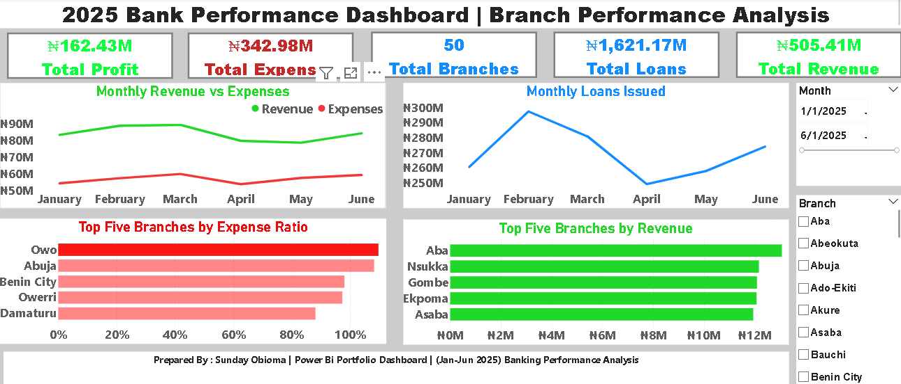

# Bank Performance Analysis Dashboard

## Project Overview

This project analyzes banking performance across 50 branches using Microsoft Power BI. The dashboard provides insights into revenue, expenses, profitability, loans issued, and branch performance.

## Project Objectives

* Evaluate overall banking profitability and expenses.
* Compare monthly revenue and expenditure trends.
* Analyze monthly loans issued.
* Identify branches with high revenue and expense ratios.
* Support data-driven business decisions through interactive visualizations.

## Tools Used

* **Microsoft Power BI:** Dashboard development and data visualization.
* **Microsoft Excel:** Dataset preparation and cleaning.
* **GitHub:** Project documentation and version control.

## Dashboard Highlights

## Dashboard Preview

The dashboard includes:

* Total Profit
* Total Expenses
* Total Branches
* Total Loans Issued
* Total Revenue
* Monthly Revenue vs. Expenses
* Monthly Loans Issued
* Top Five Branches by Expense Ratio
* Top Five Branches by Revenue
* Interactive month and branch filters

## Key Performance Indicators

## Key Performance Indicators

The dashboard reports the following key figures for the selected reporting period:

* **Total Profit:** ₦162.43M
* **Total Expenses:** ₦342.98M
* **Total Branches:** 50
* **Total Loans Issued:** ₦1,621.17M
* **Total Revenue:** ₦505.41M

## Project Files

This repository contains the following project materials:

* **Power BI Dashboard (.pbix):** Interactive dashboard for banking performance analysis.
  * [Raw Dataset](Datasets/Raw%20dataset.xlsx)
* [Cleaned Dataset](Datasets/Cleaned%20dataset/)

* **Dashboard Screenshots:** Visual previews of the dashboard and its key insights.
* [Project Report (Word)](Bank%20Performance%20Analysis%20Project%20Report.docx): Detailed documentation of the analysis, findings, and recommendations.
  
  * [Project Report (PDF)](Bank%20Performance%20Analysis-%20Project%20Report.pdf)
* [Project Presentation](Bank%20Performance%20Analysis.pptx)

* **Methodology and Key Findings:** Documentation of the analytical approach, key findings, and business insights.

## Author

Sunday Obioma
