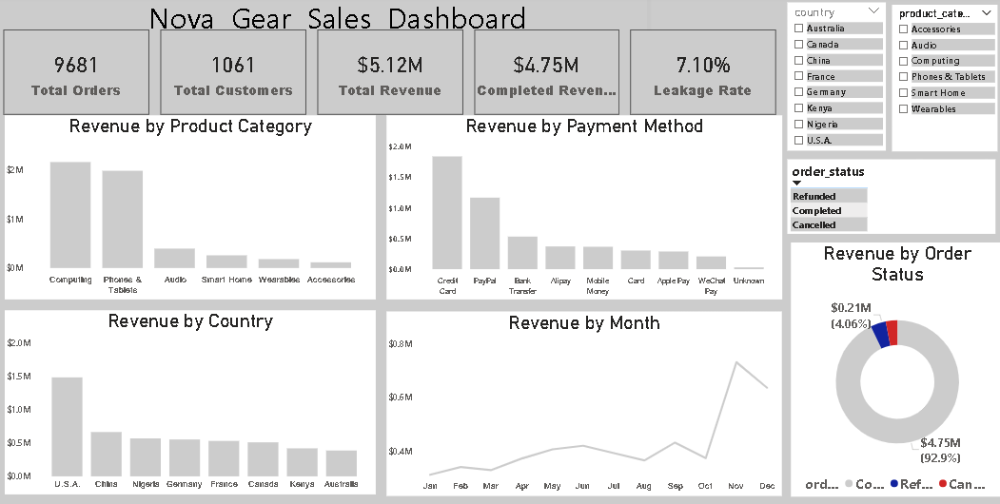

# Nova Gear Sales Analysis

## Project Overview

A data analytics project analyzing Nova Gear sales data using SQL and Power BI. The project focuses on data cleaning, sales analysis, key performance indicators (KPIs), and dashboard development.

## Project Objectives

- Clean and prepare sales data for analysis
- Analyze sales performance using SQL
- Calculate key performance indicators (KPIs)
- Identify important sales and revenue patterns
- Develop an interactive Power BI dashboard
- Communicate findings through data visualization

## Tools & Technologies

- SQL (MySQL)
- Power BI
- Excel
- Power Query
- DAX

## Project Structure

### Dashboard

### Datasets
[View Datasets](Datasets/)

Contains the raw and SQL-ready datasets used for the analysis.

### Power BI
[Open Power BI Files](Power%20BI/)

Contains the Power BI dashboard file (.pbix).

### SQL Queries
[View SQL Queries](SQL%20Queries/)

Contains the SQL queries used to analyze the Nova Gear sales data.

### Project Report
[View Project Report](Project%20Report/)

Contains the detailed project report in PDF and Word formats.
## Key Analysis Areas

- Sales performance
- Revenue analysis
- Order analysis
- Key performance indicators (KPIs)
- Sales trends and patterns
- Business insights and recommendations

## Project Outcome

The project demonstrates the use of SQL and Power BI to transform sales data into meaningful business insights and an interactive analytical dashboard.
