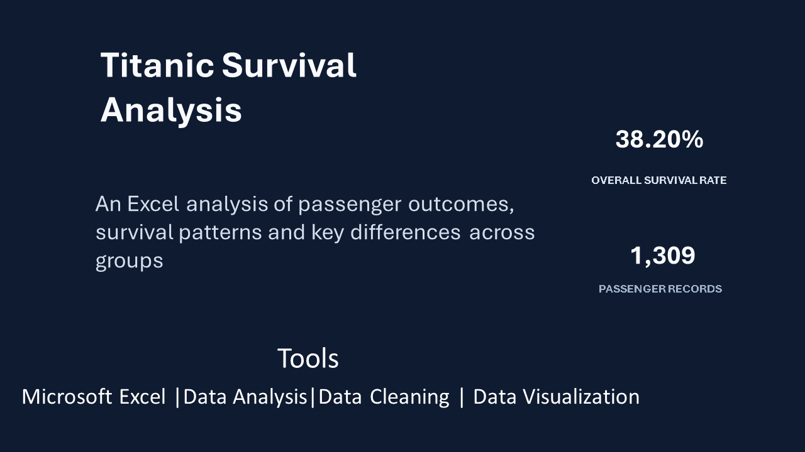
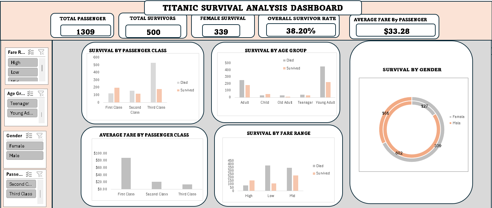

# Titanic Survival Analysis — PowerPoint Presentation

## Project Overview
This project analyzes Titanic passenger data using Microsoft Excel to identify survival patterns and key differences among passengers.

## Presentation Preview

## Excel Dashboard Preview

## Key Findings
- Total passengers analyzed: 1,309
- Total survivors: 500
- Overall survival rate: 38.20%
- Female survivors: 339
- Average fare per passenger: $33.28

## PowerPoint Presentation

[Click here to view or download the PowerPoint presentation](./Titanic_Survival_Analysis_Presentation_Updated.pptx)

## Tools Used
- Microsoft Excel
- Data Cleaning
- Data Analysis
- Data Visualization
